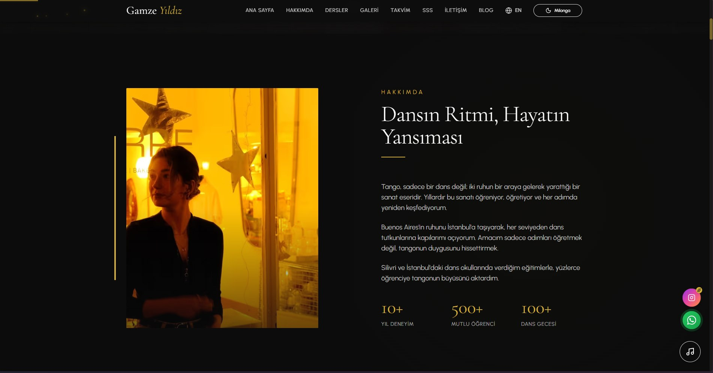

# Gamze Tango

Website for a tango teacher in Istanbul, in Turkish and English. Besides the main pages there is a landing page for each lesson type and each neighbourhood she teaches in, so a search like "private tango lesson Kadıköy" lands on a page written for that question. A bilingual blog answers the questions new dancers ask.

**Live demo:** [gamze-tango.pages.dev](https://gamze-tango.pages.dev)



## Stack

- [Next.js 14](https://nextjs.org) (App Router, static generation)
- React 18 and TypeScript
- Tailwind CSS 3
- Framer Motion
- MDX blog with `next-mdx-remote` and `gray-matter`
- Hosted on Cloudflare Pages (demo)

## What is in it

- Turkish pages at the root, English pages under `/en`, with matching routes for every lesson type.
- Location landing pages (Beyoğlu, Kadıköy, Silivri, Istanbul) built from shared `components/location` blocks.
- Service pages (private, couple and group lessons, wedding dance, lady styling, corporate workshop) built from `components/service` blocks.
- Around 50 blog posts per language in `content/blog/tr` and `content/blog/en`.
- Structured data for the dance school, courses, FAQ and how-to content (`src/lib/schema.ts`), plus sitemap, robots and `llms.txt`.
- Optional ambient music player on the blog pages, started by the visitor.

## Project structure

```
src/
  app/
    page.tsx, layout.tsx           Turkish home and shared layout
    en/                            English pages
    blog/                          Turkish blog
    ozel-tango-dersi/ ...          lesson type pages
    kadikoy-ozel-tango-dersi/ ...  location pages
    sitemap.ts
  components/
    sections/                      home page sections
    service/, location/            blocks for landing pages
    blog/, analytics/, effects/, ui/
  lib/
    blog.ts                        reads and sorts MDX posts
    schema.ts                      JSON-LD builders
    i18n/                          translations
    constants/                     site data, testimonials, audio
content/blog/{tr,en}/              blog posts
public/                            images, audio, icons, llms.txt
optimize-images.js                 image resizing script
generate-favicons.js               favicon generator
```

## Run locally

Requires Node.js 18 or newer.

```bash
npm install
cp .env.example .env.local   # optional, only for Google Analytics
npm run dev
```

Open http://localhost:3000.

## Build

```bash
npm run build          # regular Next.js build
npm run build:static   # static copy in out/ for any static host
```

To publish the static copy on Cloudflare Pages:

```bash
npx wrangler pages deploy out --project-name gamze-tango
```

## Writing a blog post

Add an `.mdx` file to `content/blog/tr` or `content/blog/en` with the same frontmatter as the existing posts (title, description, date, image). The post appears on the blog and in the sitemap on the next build.

## Credits

Design, build and content structure by [commitius](https://commitius.com). Photos and teaching content belong to Gamze Yıldız.
